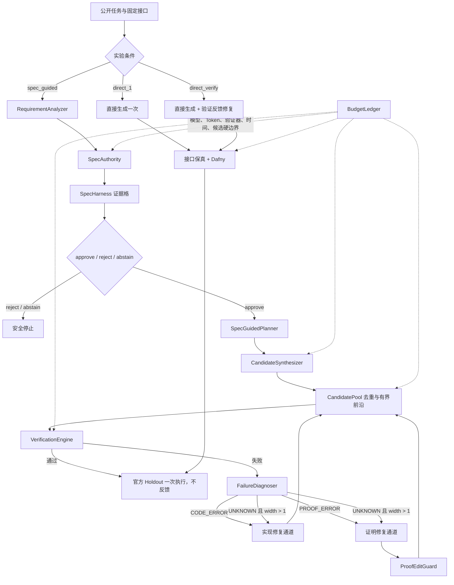

# 当前架构

系统现在由三个彼此独立的深模块边界组成：规格证据、候选搜索、实验协议。主流程只编排这些接口，不读取 Critic、Dafny 或模型客户端的内部状态。



## 关键接口

- `SpecAuthority.assess(...) -> SpecArtifact`：唯一有权创建或修订规约；批准后冻结。
- `build_spec_harness(...) -> SpecHarnessEvidence`：把结构检查、公开前置条件、可执行探针和 mutation 结果归一为证据格；未测量项保持 `unknown`。
- `CandidatePool.offer/record/best`：候选去重、父子关系、质量排序和候选上限。
- `CandidateSynthesizer.repair(..., repair_kind=...)`：实现修复与证明修复共用一个小接口；证明通道由 `ProofEditGuard` 阻止行为改写。
- `BudgetLedger`：所有条件共享相同的调用、Token、验证器、时间和候选计数规则。
- `run_agent(..., condition_id=...)`：统一运行 `direct_1`、`direct_verify`、`spec_guided`，结果使用同一 schema。

## 规格证据格

规格批准不是一个孤立布尔值。`SpecArtifact.harness` 分别记录：

- 结构可解析性；
- 前置条件是否得到公开题面支持；
- 正向公开/盲测探针；
- 错误实现是否被规约拒绝；
- 后置条件正确性与 mutation 完备性；
- 等价/唯一性和变形一致性是否已测量。

最后两项在当前版本尚无可靠实现，因此明确记录为 `unknown`，不会被误报为通过。

## 实验协议

三组主条件共享任务顺序、Holdout 隔离、资源账本和输出字段。运行示例：

```powershell
python project/run_humaneval.py --condition direct_1 --mode strict --start 0 --limit 10 --seed 0
python project/run_humaneval.py --condition direct_verify --mode strict --start 0 --limit 10 --seed 0
python project/run_humaneval.py --condition spec_guided --mode strict --start 0 --limit 10 --seed 0
```

只生成大规模作业矩阵、不发起模型调用：

```powershell
python project/build_experiment_matrix.py --output experiments/generated_jobs.json
```

固定设计见 `experiments/large_scale_matrix.json`，研究依据与统计方案见 `docs/LATEST_RESEARCH_AND_EXPERIMENT_DESIGN.md`。

## 当前边界

这次改造完成了可运行的 P0 基础设施，但没有把尚无可信证据的能力伪装成完成：

- `equivalence_or_uniqueness` 与 `metamorphic_consistency` 仍在证据格中标为 `unknown`；
- 候选池已有分支、去重、父子轨迹和预算，但当前选择规则仍是硬门禁后的 verifier-quality 排序，并非训练过的独立选择器；
- Planner 仍是条款映射计划，还不是可逐节点验收的子目标 DAG；
- 当前 HumanEval 原生类型覆盖仍约为 29/164。正式全量实验前必须建立只使用公开题面证据、经人工复核并冻结的类型表；不能从官方测试或 canonical solution 推断类型；
- 环境未配置模型 API Key 时只能运行测试、生成作业矩阵和检查协议，不能产生真实模型实验结果。
